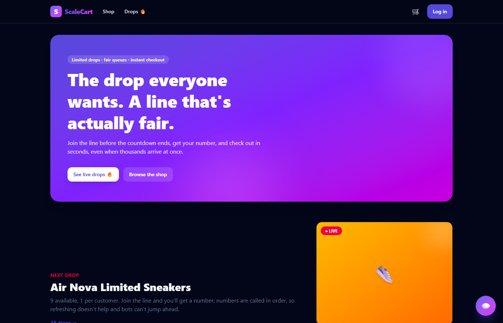
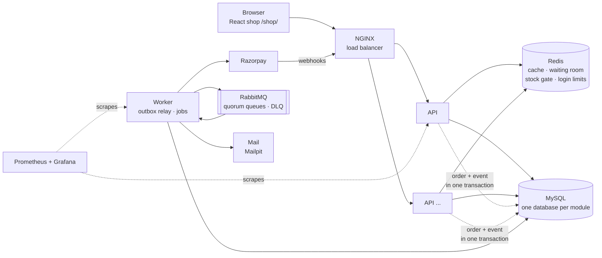
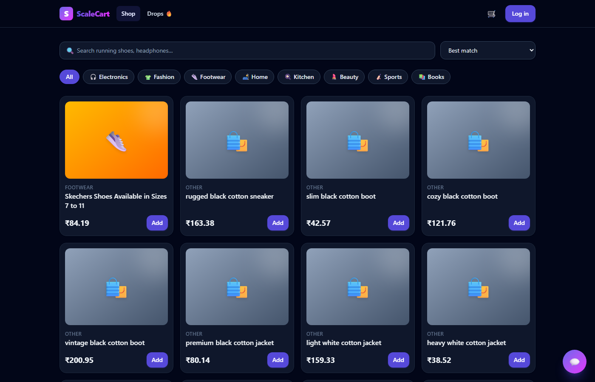
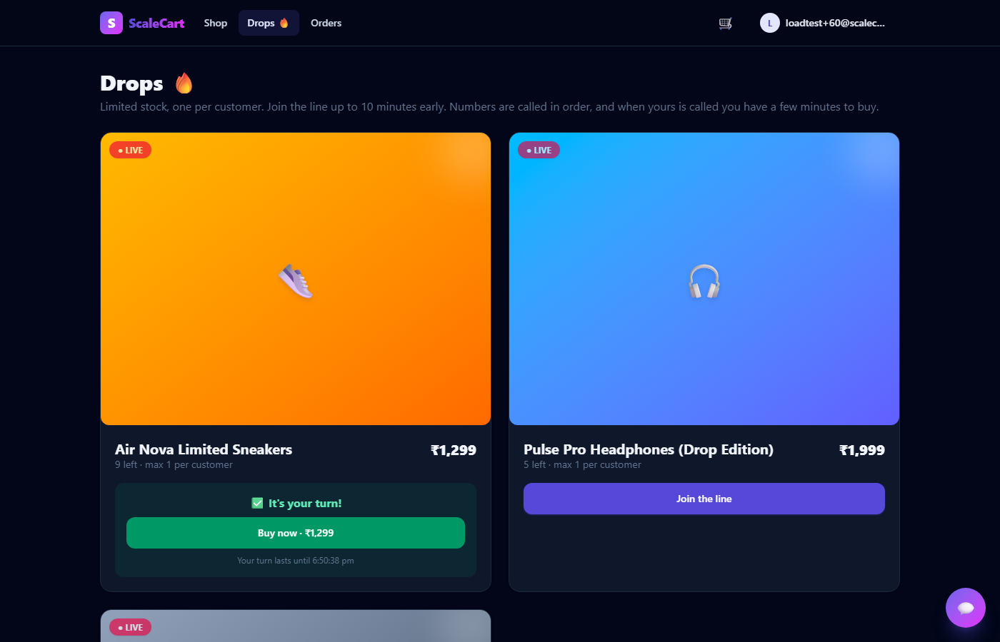
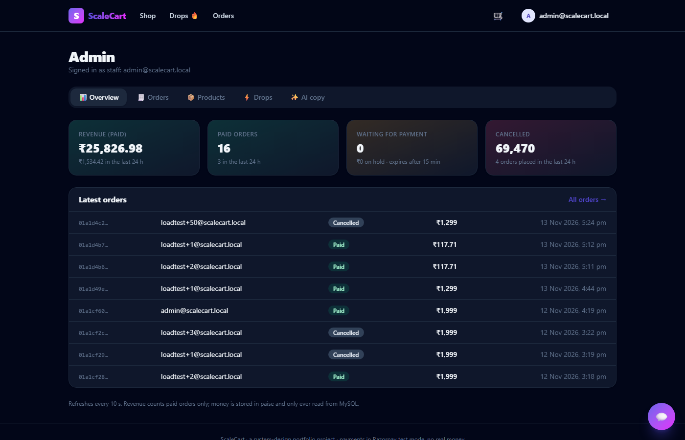
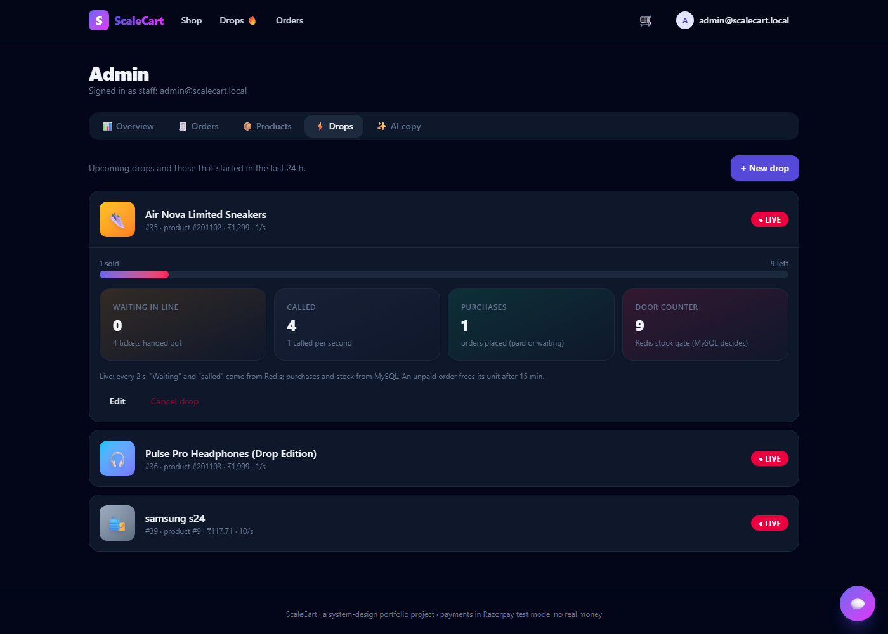

# ScaleCart

**An e-commerce platform built to survive flash-sale "drops", where 1,000 buyers hit "Buy" in the same second for
100 pairs of sneakers.** Each system-design idea in it (caching, queues, idempotency, waiting rooms, webhooks,
autoscaling) was added to fix a problem I first **measured**, then measured again after the fix.
Every number below links to the experiment that produced it.



**Stack:** Node.js 24 · TypeScript · NestJS 12 (Fastify) · MySQL 8.4 + TypeORM · Redis · RabbitMQ · React 19 + Tailwind 4 ·
Razorpay (test mode) · Gemini · Docker Compose · Kubernetes (kind) · Prometheus + Grafana · k6

---

## The problems, and what fixed them (measured)

| Problem | Fix | Result | Proof |
|---|---|---|---|
| 1,000 buyers, 100 units: a "check, then subtract" stock update **oversold ~5×** (474–499 orders) | One atomic conditional `UPDATE … WHERE available >= ?` | **Exactly 100** sold, every run | [E1](docs/experiments/E1-checkout-auth-and-queries.md) |
| Double-clicks and retries create duplicate orders | `Idempotency-Key` claimed with a primary-key INSERT | **0 duplicates** from 3,000 double-clicked requests | [E1](docs/experiments/E1-checkout-auth-and-queries.md) |
| Deep pages of 200k products are slow | Keyset pagination instead of `OFFSET` | **1 ms vs 70 ms** | [E1](docs/experiments/E1-checkout-auth-and-queries.md) |
| A burst of buyers got 504s | Traced to Node's 511-slot TCP accept queue; raised the listen backlog | **4,322 overflows → 0**, 1,000/1,000 served | [E2](docs/experiments/E2-cache-adapters-scaling.md) |
| Popular products hammer MySQL | Redis cache-aside with request coalescing | **1.6–2.1× throughput, 95–97% fewer DB reads** | [E2](docs/experiments/E2-cache-adapters-scaling.md) |
| Sending email inside checkout: a 30 s mail outage **told 60 customers "error" for orders that existed** | Transactional outbox + RabbitMQ (quorum queues, retry, dead-letter queue) + worker | **0 errors, 0 lost, 0 duplicate emails** across a frozen mail server, killed worker and restarted broker (9,480 orders) | [E3](docs/experiments/E3-outbox-queue-failures.md) |
| Payment webhooks arrive twice, late, or in a storm | HMAC check on the raw body, event-id dedup, conditional state changes, timeout job that first asks Razorpay | **100 webhooks at once → exactly 1 "paid"**, in all 6 runs; one live webhook settled in **58 ms** | [E4](docs/experiments/E4-payments.md) |
| 1,000 buyers at the drop's first second overload checkout | Virtual waiting room: Redis tickets + signed pass, admitted at the rate checkout can serve | Checkout **p50 0.26 s vs 3.7 s** without the room. A bad direct run: 259 × 504 and **~255 "ghost" orders** | [E5](docs/experiments/E5-drops-waiting-room.md) |
| One hot stock row: during a 5 s database stall, every loser waited too | Redis "door counter" in front of MySQL (Redis filters, MySQL still decides) | "Sold out" **p50 131–387 ms vs 3,980–4,228 ms**; requests in flight 120–161 vs 1,001; still **100/100 sold** | [E6](docs/experiments/E6-redis-stock-gate.md) |
| Rolling updates on Kubernetes dropped requests | Graceful drain: `Connection: close` + not-ready for 5 s, then close | **27–67 failed requests → 0** (6/6 runs) | [E7](docs/experiments/E7-kubernetes.md) |
| Autoscaling to 5 pods exhausted MySQL connections (761 of 1,000 checkouts failed) | Connection budget: pods × pools × pool size < `max_connections` | 5 pods use **72–75** connections | [E7](docs/experiments/E7-kubernetes.md) |
| An AI shopping assistant is slow and expensive | Measured where the time goes | Model rounds **1.2–1.8 s each**, our tools **16–113 ms**: latency = number of rounds | [E3.5](docs/experiments/E3.5-ai-assistant.md) |

Also measured: one Node.js process handles ~4.3k trivial req/s, but 5 ms of CPU work drops that to ~150
([E0](docs/experiments/E0-calibration-and-event-loop.md)). Fastify is +25–40% over Express
([E2](docs/experiments/E2-cache-adapters-scaling.md)). The shop's first visit downloads 122.5 KB of gzipped JavaScript
([E8](docs/experiments/E8-storefront.md)).

> All numbers come from one laptop (i7-12650H, Docker Desktop); identical runs vary up to ~25%, so claims are based on
> repeated runs. The test rig itself tops out near 8k req/s.

## How it fits together



- **Modular monolith:** identity, catalog, inventory, cart, orders, payments, drops and AI are separate modules. Each
  owns its own MySQL database and talks to the others only through services, so splitting into microservices later is
  cheap.
- **The API never talks to RabbitMQ.** It writes the order and an "order.created" event in one transaction (the
  outbox). The worker relays the event, sends the emails, expires unpaid orders and reconciles payments.
- **Money paths always read MySQL.** Redis only speeds things up (cache, queue tickets, the stock gate). If Redis goes
  down, drops pause but can never oversell.

Step-by-step journeys (no code): [docs/scalecart-workflow.md](docs/scalecart-workflow.md).

## What you can do in it

| | |
|---|---|
|  |  |
| **Shop:** search, categories, cart, checkout with Razorpay test mode, order tracking | **Drops:** countdown on the server's clock, join the line, "It's your turn" → Buy now |
|  |  |
| **Admin:** revenue, all orders, products and stock, AI-written product copy | **Live drop monitor:** people in line, called, sold, stock left, Redis door counter |

Plus an **AI shopping assistant** (chat bubble), built as a hand-written agent loop with 5 tools. The user id always
comes from the login token, never from the model. There is also a read-only **MCP server** at `POST /mcp`.

## Run it

Needs Docker Desktop and Node 24 (k6 only for the load tests).

```powershell
Copy-Item .env.example .env        # fill in your own secrets; .env is never committed
cd apps/web; npm install; npm run build; cd ../..     # the shop, served by NGINX at /shop/
docker compose up -d --build       # mysql, redis, rabbitmq, mailpit, migrations, api, worker, nginx, prometheus, grafana
docker compose run --rm -e SEED_PRODUCTS=200000 -e SEED_USERS=2000 migrate node dist/seed.js   # demo data
```

Open **http://localhost:8088/shop/**. Log in as:
- **Admin:** `admin@scalecart.local`, password = `ADMIN_PASSWORD` from `.env`.
- **Customers:** `loadtest+1@scalecart.local` … `loadtest+2000@scalecart.local`, password = `SEED_USER_PASSWORD`.

Optional in `.env`:
- `RAZORPAY_*` for test-mode payments. Webhooks need a public URL: put your free ngrok fixed domain in
  `NGROK_DOMAIN` and run `./infra/tunnel.ps1`, then set `https://<domain>/payments/razorpay/webhook` in the dashboard once.
- `GEMINI_API_KEY` for the AI features.

| URL | What |
|---|---|
| http://localhost:8088/shop/ | The storefront (admin area at `/shop/admin`) |
| http://localhost:8088/docs | Swagger: every API endpoint, try them in the browser |
| http://localhost:3001 | Grafana dashboard |
| http://localhost:9090 | Prometheus |
| http://localhost:8025 | Mailpit: every email the shop sends |
| http://localhost:15672 | RabbitMQ management (`scalecart` / `RABBITMQ_PASSWORD`) |

Kubernetes instead of Compose: `./k8s/up.ps1` (kind, probes, graceful drain, autoscaler). API at
http://localhost:8089.

### Tests

```powershell
cd apps/api; npm test; npm run test:e2e   # 64 unit, 181 end-to-end (needs: docker compose up -d mysql redis rabbitmq mailpit)
cd apps/web; npm test                     # 21 component tests with a fake API
```

The end-to-end suite runs against real MySQL, Redis and RabbitMQ; the core shop, auth and payment suites run on both
Fastify and Express. Key tests are
**mutation-checked**: I broke the code on purpose and confirmed the test failed.

### Load tests

```powershell
./load-tests/run.ps1 -Script e1-flash-sale.js            # 1,000 buyers, 100 units
./load-tests/run.ps1 -Script e5-drop.js                  # a drop with the waiting room
```

`run.ps1` prints a per-step table and checks that k6 itself wasn't the bottleneck. Switches for the experiments include
`STOCK_RESERVATION=atomic|locking|naive`, `HTTP_ADAPTER=fastify|express`, `NOTIFY_MODE=outbox|sync`, `CACHE_ENABLED`,
`DROP_STOCK_GATE`, `API_REPLICAS` and `API_CPUS`.

## Repository layout

```
apps/api/              NestJS: one folder per module; dist/main.js = API, dist/worker.js = background worker (same image)
apps/web/              React + Tailwind storefront and admin area (Vite)
apps/demo/             the earlier one-page demo (/demo/)
infra/                 MySQL init, NGINX, Prometheus, Grafana (dashboards provisioned automatically)
k8s/                   kind cluster, probes, autoscaler
load-tests/            k6 scripts and the runner
docs/experiments/      E0–E8: every experiment with its real numbers
docs/interview-notes/  how to explain each phase: story → proof → fix → trade-off
```

## Roadmap

| | |
|---|---|
| ✅ Done | Shop core, caching, queues + outbox, Razorpay payments, drops + waiting room, Redis stock gate, Kubernetes, AI assistant, React storefront + admin |
| Next | API-wide rate limiting · 2FA · microservice split (payments first) · API gateway · distributed tracing · cloud load tests |

What isn't built yet, honestly: real refunds in live test mode, reconciliation of lost webhooks, push "your turn"
notifications (the drop page polls), and Lighthouse or real-browser tests for the shop.
