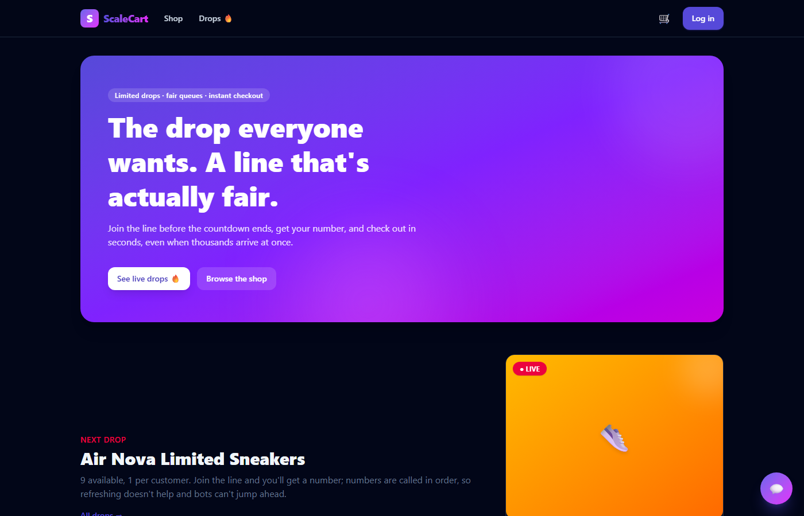
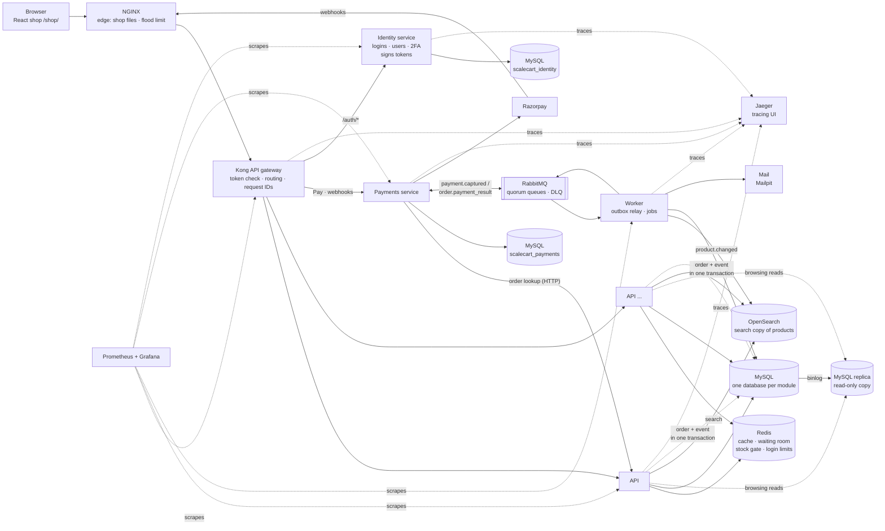
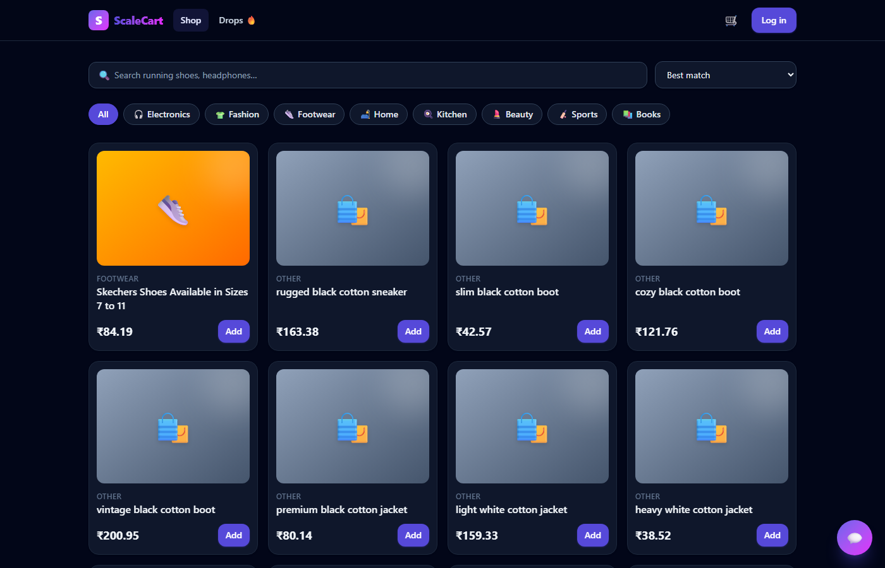
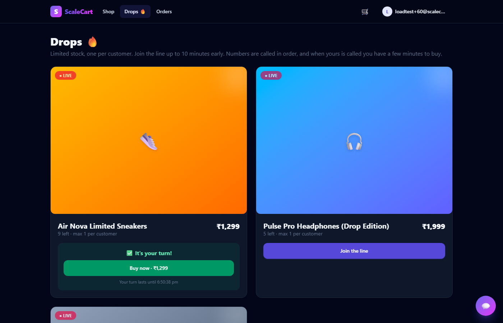
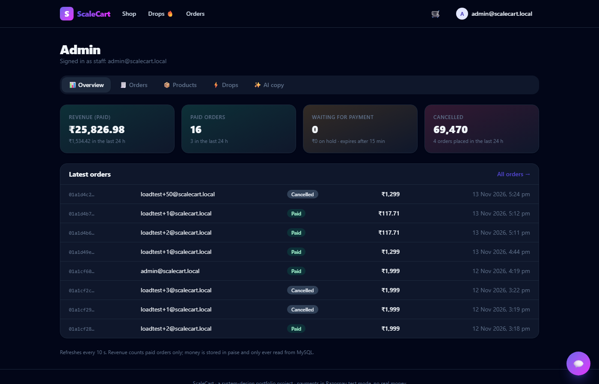
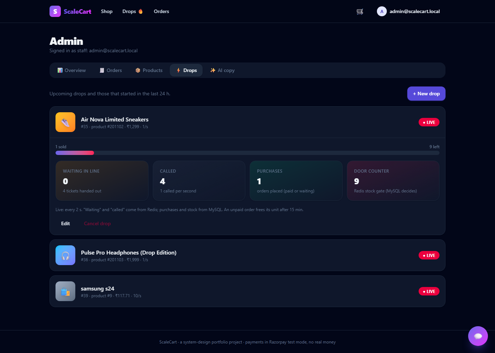

# ScaleCart

**An e-commerce platform built to survive flash-sale "drops", where 1,000 buyers hit "Buy" in the same second for
100 pairs of sneakers.** Each system-design idea in it (caching, queues, idempotency, waiting rooms, webhooks,
autoscaling) was added to fix a problem I first **measured**, then measured again after the fix.
Every number below links to the experiment that produced it.



**Stack:** Node.js 24 · TypeScript · NestJS 12 (Fastify) · MySQL 8.4 + TypeORM · Redis · RabbitMQ · OpenSearch · React 19 + Tailwind 4 ·
Razorpay (test mode) · Gemini · Docker Compose · Kubernetes (kind) · Prometheus + Grafana · k6

---

## The problems, and what fixed them (measured)

| Problem | Fix | Result | Proof |
|---|---|---|---|
| 1,000 buyers, 100 units: a "check, then subtract" stock update **oversold ~5×** (474–499 orders) | One atomic conditional `UPDATE … WHERE available >= ?` | **Exactly 100** sold, every run | [E1](docs/experiments/E1-checkout-auth-and-queries.md) |
| Double-clicks and retries create duplicate orders | `Idempotency-Key` claimed with a primary-key INSERT | **0 duplicates** from 3,000 double-clicked requests | [E1](docs/experiments/E1-checkout-auth-and-queries.md) |
| Deep pages of 200k products are slow | Keyset pagination instead of `OFFSET` | **1 ms vs 70 ms** | [E1](docs/experiments/E1-checkout-auth-and-queries.md) |
| A burst of buyers got 504s | Traced to Node's 511-slot TCP accept queue; raised the listen backlog | **4,322 overflows → 0**, 1,000/1,000 served | [E2](docs/experiments/E2-cache-adapters-scaling.md) |
| Popular products hammer MySQL | Redis cache-aside with request coalescing | **1.6–2.1× throughput, 95–97% fewer DB reads** | [E2](docs/experiments/E2-cache-adapters-scaling.md) |
| Sending email inside checkout: a 30 s mail outage **told 60 customers "error" for orders that existed** | Transactional outbox + RabbitMQ (quorum queues, retry, dead-letter queue) + worker | **0 errors, 0 lost, 0 duplicate emails** across a frozen mail server, killed worker and restarted broker (9,480 orders) | [E3](docs/experiments/E3-outbox-queue-failures.md) |
| Payment webhooks arrive twice, late, or in a storm | HMAC check on the raw body, event-id dedup, conditional state changes, timeout job that first asks Razorpay | **100 webhooks at once → exactly 1 "paid"**, in all 6 runs; one live webhook settled in **58 ms** | [E4](docs/experiments/E4-payments.md) |
| 1,000 buyers at the drop's first second overload checkout | Virtual waiting room: Redis tickets + signed pass, admitted at the rate checkout can serve | Checkout **p50 0.26 s vs 3.7 s** without the room. A bad direct run: 259 × 504 and **~255 "ghost" orders** | [E5](docs/experiments/E5-drops-waiting-room.md) |
| One hot stock row: during a 5 s database stall, every loser waited too | Redis "door counter" in front of MySQL (Redis filters, MySQL still decides) | "Sold out" **p50 131–387 ms vs 3,980–4,228 ms**; requests in flight 120–161 vs 1,001; still **100/100 sold** | [E6](docs/experiments/E6-redis-stock-gate.md) |
| Rolling updates on Kubernetes dropped requests | Graceful drain: `Connection: close` + not-ready for 5 s, then close | **27–67 failed requests → 0** (6/6 runs) | [E7](docs/experiments/E7-kubernetes.md) |
| Autoscaling to 5 pods exhausted MySQL connections (761 of 1,000 checkouts failed) | Connection budget: pods × pools × pool size < `max_connections` | 5 pods use **72–75** connections | [E7](docs/experiments/E7-kubernetes.md) |
| One scraper (1,500 searches/s) failed 1,033–2,161 of 3,000 shopper requests | Token bucket per user in Redis (Lua) + NGINX edge limit per token + a backup bucket in each pod | Shoppers' p95 **7.0–7.2 ms under attack** (9.8 ms with no attacker), 0 errors in 3 of 4 runs. App limiter alone wasn't enough: Node was 100% busy refusing, and fail open leaked 18,373 requests | [E9](docs/experiments/E9-rate-limiting.md) |
| A stolen password is enough to log in | Two-step login with an authenticator app (TOTP, RFC 6238), atomic attempt counter in MySQL, replay protection, encrypted secrets | 30 code guesses at once → **exactly 5 checked** (naive version: 30 of 30); server clock within 0.2 s of a ±30 s tolerance | [E10](docs/experiments/E10-two-factor.md) |
| Payments shared one process with the shop: a shop crash also refused Razorpay's webhooks | Payments split into its own service: one sync call (timeout, retry, circuit breaker), everything else as events with an outbox on both sides | Shop down 60 s: **60/60 webhooks accepted**, all orders paid 4–5 s after restart. Payments down: browsing and checkout unchanged. Cost: ~1 ms per hop (p99 8–26 ms), order paid ~0.1 s after the webhook | [E11](docs/experiments/E11-payments-service.md) |
| Every fake login token cost the shop CPU: a flood of 1,000/s, each token different, slips past per-token limits | Kong API gateway in front of the services: token check at the door, routing, request IDs | Shop CPU under the flood **15–16% vs 50–52%** (no attack: 14–17%), shoppers' p95 **9–16 ms vs 23–36 ms**. Cost: ~1 ms per request. Found: NGINX's default health check kept customers out **13 s** after Kong was back (fixed: ~0.2 s) | [E12](docs/experiments/E12-api-gateway.md) |
| "Pay is slow" — but where? Metrics can't say, and one payment touches 3 services and 2 queue hops | Distributed tracing: OpenTelemetry in every service, Kong starts the trace, the outbox carries it through RabbitMQ, Jaeger shows it | Over 20 Pays: **79% of the time is Razorpay's API** (265 of 321 ms), the shop lookup 2.6 ms. A planted 2.8 s lock found from **one trace**. Cost: shop CPU ≈39% → ≈53% at 300 req/s (≈49% sampled at 10%) | [E13](docs/experiments/E13-tracing.md) |
| A login rush (Argon2 on purpose) filled the shop's CPU: at 15 logins/s shoppers' p95 was 6–7 s, with timeouts. And one shared token secret meant a leak anywhere = forge any login | Identity split into its own service; tokens RS256 (only identity holds the private key, everyone else the public key); the customer's email travels in the event | Same rush: shoppers' p95 **14–15 ms, 0 errors** (even with the same total CPU: 0 errors). Identity down 60 s: signed-in shoppers unaffected; an outage test first **lost confirmation emails**, fixed (sent within 0.3 s). Key rotation under traffic: 0 errors | [E14](docs/experiments/E14-identity-service.md) |
| Search on MySQL FULLTEXT: a typo = an empty page, and 50 searches/s used more than a whole MySQL core (the one checkout needs) | OpenSearch as a read copy (CQRS), kept in sync by outbox events; MySQL as the backup behind a circuit breaker and a bulkhead | Test queries found **20/20 vs 9/20** (typos 9/9 vs 0/9); MySQL CPU at 50 searches/s **~4.5% vs 100–124%**; an edit is searchable after **p50 0.8 s**. Failure tests found 3 bugs: the backup overloaded MySQL, the breaker re-opened itself 2,362×, a stopped OpenSearch broke the **cart** via slow DNS lookups (fixed: 0 failures) | [E15](docs/experiments/E15-search-cqrs.md) |
| One MySQL served checkout AND every browsing read, incl. a dashboard that scans all orders | A read replica (async, GTID) for reads that may be a moment old; read-your-writes with `WAIT_FOR_EXECUTED_GTID_SET`; lag guard + bulkhead | Primary CPU **82–84% → 19–27%** at a moderate load. Without read-your-writes **18–76 of 100** customers didn't see the order they had just placed; with it **0 of 194** (0.8 ms extra). Found: an overloaded replica looked "down" and flooded the primary (checkout p50 22–30 s); with the bulkhead **0.6–0.7 s** | [E16](docs/experiments/E16-read-replica.md) |
| The same order event delivered 10 times at once sent up to 10 confirmation emails: the worker checked "already sent?", sent, then recorded | Claim before sending: one INSERT (event id = primary key) decides who sends; losers skip or retry; stale claims are taken over | Redelivery storm: **196 and 169 emails → 20** for 20 orders (×2), **50 for 50** with 20 copies each | [E17](docs/experiments/E17-email-duplicates.md) |
| An AI shopping assistant is slow and expensive | Measured where the time goes | Model rounds **1.2–1.8 s each**, our tools **16–113 ms**: latency = number of rounds | [E3.5](docs/experiments/E3.5-ai-assistant.md) |

Also measured: one Node.js process handles ~4.3k trivial req/s, but 5 ms of CPU work drops that to ~150
([E0](docs/experiments/E0-calibration-and-event-loop.md)). Fastify is +25–40% over Express
([E2](docs/experiments/E2-cache-adapters-scaling.md)). The shop's first visit downloads 122.5 KB of gzipped JavaScript
([E8](docs/experiments/E8-storefront.md)).

> All numbers come from one laptop (i7-12650H, Docker Desktop); identical runs vary up to ~25%, so claims are based on
> repeated runs. The test rig itself tops out near 8k req/s.

## How it fits together



- **One front door:** NGINX serves the shop's files and stops floods; every API request then goes through **Kong**, the
  API gateway, which checks login tokens, sends the request to the shop or payments, blocks internal routes and gives
  each request an `X-Request-ID`. The services still verify tokens themselves.
- **Every request can be followed:** OpenTelemetry traces each request through Kong, the services, MySQL, Redis and
  RabbitMQ (the trace rides along in the outbox), shown in **Jaeger**. Responses carry `X-Trace-Id`.
- **A modular monolith + two services:** catalog, inventory, cart, orders, drops and AI are modules of the shop, each
  with its own MySQL database. **Payments** (`apps/payments`) and **identity** (`apps/identity`) are separate
  services with their own database logins. Identity alone signs login tokens (RS256, private key); Kong, the shop and
  payments only check them with its public keys, so none of them could forge a login.
- **The API never talks to RabbitMQ.** It writes the order and an "order.created" event in one transaction (the
  outbox). The worker relays the event, sends the emails, marks orders paid when payments says so, and expires unpaid orders
  (after asking payments first).
- **Search reads a copy (CQRS).** MySQL holds the products; OpenSearch holds a search-friendly copy (typos forgiven,
  ranked, facets), updated from `product.changed` events through the outbox. If OpenSearch is down, MySQL answers,
  a few at a time.
- **Browsing reads a copy of the database.** Product lists, order history and the admin dashboard read a MySQL
  replica a few ms behind; a customer's own orders wait until the copy has their latest checkout. Writes and money
  reads never use it.
- **Money paths always read MySQL.** Redis only speeds things up (cache, queue tickets, the stock gate). If Redis goes
  down, drops pause but can never oversell.

Step-by-step journeys (no code): [docs/scalecart-workflow.md](docs/scalecart-workflow.md).

## What you can do in it

| | |
|---|---|
|  |  |
| **Shop:** search, categories, cart, checkout with Razorpay test mode, order tracking | **Drops:** countdown on the server's clock, join the line, "It's your turn" → Buy now |
|  |  |
| **Admin:** revenue, all orders, products and stock, AI-written product copy | **Live drop monitor:** people in line, called, sold, stock left, Redis door counter |

Plus an **AI shopping assistant** (chat bubble), built as a hand-written agent loop with 5 tools. The user id always
comes from the login token, never from the model. There is also a read-only **MCP server** at `POST /mcp`.

## Run it

Needs Docker Desktop and Node 24 (k6 only for the load tests).

```powershell
Copy-Item .env.example .env        # fill in your own secrets; .env is never committed
node infra/identity/new-signing-key.mjs               # the RSA key that signs login tokens (written into .env)
cd apps/web; npm install; npm run build; cd ../..     # the shop, served by NGINX at /shop/
docker compose build api; docker compose build payments; docker compose build identity   # one at a time (parallel builds race)
docker compose up -d               # mysql + its read replica, redis, rabbitmq, mailpit, opensearch, migrations, api, worker, payments, identity, kong, nginx, …
docker compose run --rm -e SEED_PRODUCTS=200000 migrate node dist/seed.js         # demo products
docker compose run --rm migrate node dist/reindex.js                              # copy them into OpenSearch (search)
docker compose run --rm -e SEED_USERS=2000 identity-migrate node dist/seed.js     # the admin + load-test users
```

Open **http://localhost:8088/shop/**. Log in as:
- **Admin:** `admin@scalecart.local`, password = `ADMIN_PASSWORD` from `.env`.
- **Customers:** `loadtest+1@scalecart.local` … `loadtest+2000@scalecart.local`, password = `SEED_USER_PASSWORD`.

Optional in `.env`:
- `RAZORPAY_*` for test-mode payments. Webhooks need a public URL: put your free ngrok fixed domain in
  `NGROK_DOMAIN` and run `./infra/tunnel.ps1`, then set `https://<domain>/payments/razorpay/webhook` in the dashboard once.
- `GEMINI_API_KEY` for the AI features.

| URL | What |
|---|---|
| http://localhost:8088/shop/ | The storefront (admin area at `/shop/admin`) |
| http://localhost:8088/docs | Swagger: every API endpoint, try them in the browser |
| http://localhost:3001 | Grafana dashboard |
| http://localhost:9090 | Prometheus |
| http://localhost:16686 | Jaeger: traces (paste a response's `X-Trace-Id`) |
| http://localhost:9200 | OpenSearch (the search copy; e.g. `/products/_count`) |
| http://localhost:8025 | Mailpit: every email the shop sends |
| http://localhost:15672 | RabbitMQ management (`scalecart` / `RABBITMQ_PASSWORD`) |

Kubernetes instead of Compose: `./k8s/up.ps1` (kind, probes, graceful drain, autoscaler). API at
http://localhost:8089.

### Tests

```powershell
cd apps/api; npm test; npm run test:e2e        # shop: 77 unit, 155 end-to-end (needs: docker compose up -d mysql mysql-replica redis rabbitmq mailpit opensearch)
cd apps/payments; npm test; npm run test:e2e   # payments service: 18 unit, 29 end-to-end
cd apps/identity; npm test; npm run test:e2e   # identity service: 16 unit, 26 end-to-end (logins, 2FA, keys, rotation)
node infra/kong/check-gateway.mjs              # 16 gateway rules against the running stack (tokens, routes, 404s)
node infra/jaeger/check-tracing.mjs            # a real payment, traced end to end through RabbitMQ (reads Jaeger)
cd apps/web; npm test                          # 25 component tests with a fake API
```

The end-to-end suite runs against real MySQL, Redis and RabbitMQ; the core shop suites run on both
Fastify and Express. Key tests are
**mutation-checked**: I broke the code on purpose and confirmed the test failed.

### Load tests

```powershell
./load-tests/run.ps1 -Script e1-flash-sale.js            # 1,000 buyers, 100 units
./load-tests/run.ps1 -Script e5-drop.js                  # a drop with the waiting room
```

`run.ps1` prints a per-step table and checks that k6 itself wasn't the bottleneck. Switches for the experiments include
`STOCK_RESERVATION=atomic|locking|naive`, `HTTP_ADAPTER=fastify|express`, `NOTIFY_MODE=outbox|sync`, `CACHE_ENABLED`,
`DROP_STOCK_GATE`, `RATE_LIMIT_ENABLED`, `SEARCH_ENGINE=opensearch|mysql`, `READ_REPLICA=on|off`, `API_REPLICAS` and `API_CPUS`. The rate limiter is on by default; older load
tests send everything from one IP, so run them with `RATE_LIMIT_ENABLED=false`.

## Repository layout

```
apps/api/              NestJS: one folder per module; dist/main.js = API, dist/worker.js = background worker (same image)
apps/payments/         NestJS: the payments service (Razorpay, its own database and outbox)
apps/identity/         NestJS: the identity service (logins, users, 2FA; the only holder of the token signing key)
apps/web/              React + Tailwind storefront and admin area (Vite)
apps/demo/             the earlier one-page demo (/demo/)
infra/                 MySQL init, NGINX (edge), Kong (API gateway), Jaeger (tracing), Prometheus, Grafana (dashboards provisioned automatically)
k8s/                   kind cluster, probes, autoscaler
load-tests/            k6 scripts and the runner
docs/experiments/      E0–E17: every experiment with its real numbers
docs/interview-notes/  how to explain each phase: story → proof → fix → trade-off
```

## Roadmap

| | |
|---|---|
| ✅ Done | Shop core, caching, queues + outbox, Razorpay payments, drops + waiting room, Redis stock gate, Kubernetes, AI assistant, React storefront + admin, API-wide rate limiting, two-step login (authenticator app), payments as its own service, API gateway (Kong), distributed tracing (OpenTelemetry + Jaeger), identity as its own service (RS256 tokens), search engine + CQRS (OpenSearch), MySQL read replica |
| Next | Other system-design topics (CDN…) · cloud load tests |
What isn't built yet, honestly: real refunds in live test mode, reconciliation of lost webhooks, push "your turn"
notifications (the drop page polls), and Lighthouse or real-browser tests for the shop.
